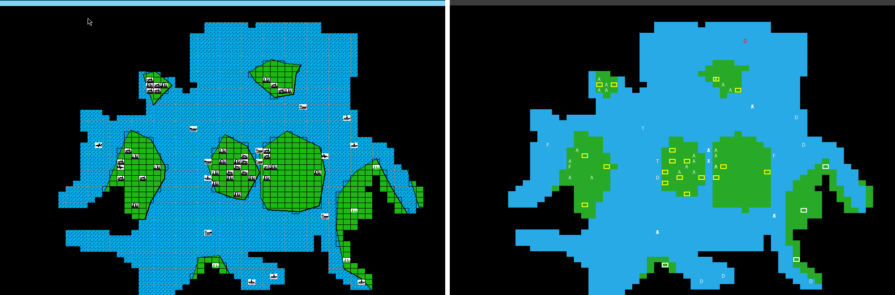

# Save-file format (3.01)

Status: block layout confirmed from the code; main records decoded; some fields still unknown.
`tools/save/sc3save.py` implements everything here.

**Verification.** `saves/3.01/s04-day58-autoplay.sav` was loaded in the emulator and the
screen compared with the parser's rendering of the human player's view, columns 8–68,
rows 1–54 (left: emulator, right: parser). Terrain, explored area, city positions, and the
position and type of every piece shown on screen match. The computer's pieces outside the
human player's current sight appear only on the right, because the game hides them.

## General

- 11,381 bytes, data fork only. Mac type `SC∂ `, creator `SCÆ `.
- Written only at the end of a round. Loading is also deferred to the end of the round.
- The file is a straight dump of 23 global variables: the save routine (Gstart,
  `CODE 10 + 0x0542..0x07FA`) writes them with FSWrite, and the load routine (Main,
  `CODE 1 + 0x0A9A..0x0DD2`) reads them back in the same order.
- Not saved: the current state of either random generator (see
  [findings.md](findings.md#randomness)), and the island-number map at `A5-$3672`
  (80×60 nibbles), which must be rebuilt after loading.

## Coordinates

- 1-based: x (column) 1–80, y (row) 1–60. The outer ring is the map edge (terrain 5), so
  the playable area is x 2–79, y 2–59.
- The column and row labels on the game screen are these coordinates.
- Records store positions as byte pairs in **(y, x)** order.

## Blocks

| File offset | Size | Global | Name | Contents |
|---|---|---|---|---|
| 0 | 4 | A5-$1E70 | seed | Starting seed for the game (constant within a game) |
| 4 | 1 | A5-$1E71 | game_mode | 0 single player, 1 two players on one Mac, 2 AppleTalk Master, 3 AppleTalk Slave (see [rules/units.md](rules/units.md)) |
| 5 | 1 | A5-$2CE6 | skill | Skill level |
| 6 | 2 | A5-$2D08 | day | Day number (incremented at the top of the main day loop, `CODE 1 + 0x195C`) |
| 8 | 2400 | A5-$27D2 | terrain | Map, see below |
| 2408 | 6314 | A5-$5138 | pieces | Piece table, see below |
| 8722 | 1284 | A5-$2CD8 | player_maps | Two per-player structures, see below |
| 10006 | 1 | A5-$1E71 | game_mode_2 | Same variable as offset 4, written again |
| 10007 | 460 | A5-$385E | cities | City table, see below |
| 10467 | 2 | A5-$388E | piece_count | Highest piece slot in use |
| 10469 | 352 | A5-$1BFC | cur_islands | Per-island records for the player whose turn it is, see below |
| 10821 | 352 | A5-$0F86 | oth_islands | Same, for the other player |
| 11173 | 32 | A5-$1C4E | cur_1C4E | Current player: 16 words, one per island (cleared per island at setup). Meaning unknown |
| 11205 | 32 | A5-$0CBC | oth_0CBC | Other player's copy |
| 11237 | 46 | A5-$1C8C | cur_1C8C | Current player: 46 bytes (possibly one per city, 0–45). Meaning unknown |
| 11283 | 46 | A5-$0C7C | oth_0C7C | Other player's copy |
| 11329 | 16 | A5-$1C5E | cur_1C5E | Current player: 16 bytes (possibly one per island). Meaning unknown |
| 11345 | 16 | A5-$0C20 | oth_0C20 | Other player's copy |
| 11361 | 2 | A5-$1C02 | cur_1C02 | Current player word. Meaning unknown |
| 11363 | 2 | A5-$0CC6 | oth_0CC6 | Other player's copy |
| 11365 | 2 | A5-$1C2E | cur_1C2E | Current player word. Meaning unknown |
| 11367 | 2 | A5-$0CC0 | oth_0CC0 | Other player's copy |
| 11369 | 12 | A5-$2CE4 | blk_2CE4 | Unknown; zero in all saves so far |

**Current vs other player.** The game keeps one set of "current player" variables and a
stored copy for the other player, and swaps them when the turn changes
(`CODE 1 + 0x2C8C..0x2D6C`). The `cur_`/`oth_` blocks are those two sets as they stood
when the save was written.

## Terrain (offset 8, 2400 bytes)

- 4 bits per cell, column-major: cell (x, y) is nibble number (x − 1)·60 + (y − 1).
  Even-numbered nibbles are the low half of the byte.
- Values: 0 water, 3 land, 5 map edge.
- City cells hold 1 << owner: **1** neutral, **2** player 1, **4** player 2. They change when
  a city is captured.

## Pieces (offset 2408, 6314 bytes)

451 records of 14 bytes. Record 0 is unused; records 1..`piece_count` are live unless their
type is 9 (empty slot). The table holds at most 450 pieces.

| Byte | Meaning |
|---|---|
| 0–1 | (y, x) point A. Set to the build position; later use not yet decoded |
| 2–3 | (y, x) point B: destination when the piece has go-to orders (a new piece copies its city's Army destination here) |
| 4–5 | (y, x) point C. Set to the build position; later use not yet decoded |
| 6–7 | (y, x) current position |
| 8–9 | Big-endian word. Bits 0–4: current move step within the day (1-based). Bits 5–9: fuel (Fighter, Bomber) or cargo count (Transport, Carrier). Bits 10–15: Bomber blast radius |
| 10 | Bits 0–3 type, bits 4–5 owner (1 or 2), bits 6–7 unknown |
| 11 | Bit 2: has moved this day. Bits 3–4: orders (2 = go to destination). Bits 6–7: state (1 when built; 2 while awaiting repair, reset to 1 when fully repaired). Bits 0, 1 and 5 not yet decoded |
| 12 | Bits 0–4 strength. Bits 6–7: spotted (set on a Submarine found by a Destroyer; 0 means it strikes first when attacked, see [combat](rules/combat.md)). Bit 5 unknown |
| 13 | 1 once a ship has been repaired during its current stay in port |

Type codes (a lookup table in EMPINIT, `CODE 2 + 0x2D0E`, maps them to the STR names):

| 0 | 1 | 2 | 3 | 4 | 5 | 6 | 7 | 8 | 9 |
|---|---|---|---|---|---|---|---|---|---|
| Army | Fighter | Destroyer | Submarine | Carrier | Transport | Battleship | Bomber | "removed" | empty |

Note that Carrier (4) and Transport (5) are in the opposite order from the STR list and the
production dialog.

Moves remaining are not stored in the record; the status-line routine (`CODE 5 + 0x5450`)
receives them from its caller.

## Player maps (offset 8722, 1284 bytes)

Two 642-byte structures, player 1 then player 2.

| Bytes | Meaning |
|---|---|
| 0–639 | Explored-cells bitmap: 8 bytes per column, column x at (x − 1)·8; cell (x, y) is bit (y − 1), least significant bit first |
| 640 | 1 if the computer controls this player. Player 2 is always 1 in single-player games; player 1 is 1 while Auto Play is on, so Auto Play resumes when the save is loaded |
| 641 | Unknown (0 so far) |

## Cities (offset 10007, 460 bytes)

46 records of 10 bytes. Record 0 is unused; 45 cities (records 1–45).

| Byte | Meaning |
|---|---|
| 0–1 | (y, x) position |
| 2–3 | (y, x). Equal to the position in every save so far; possibly the city's Army destination ("CAD" in the production dialog) |
| 4 | Owner: 0 neutral, 1 player 1, 2 player 2 |
| 5 | Days until the current unit is complete |
| 6–7 | (y, x). Equal to the position in every save so far; possibly the aircraft destination ("CAAD") |
| 8 | Piece type in production (codes above) |
| 9 | Island number (1–15) |

## Per-island records (offsets 10469 and 10821, 352 bytes each)

16 records of 22 bytes, indexed by island number (0 = no island). The computer-opponent code
indexes them by the island-number map (`CODE 6 + 0x0364` tests bit 6 of byte 15). Byte 21
of records 1–15 holds a day number, the current day or earlier. Other fields not yet decoded.

## Open

- Piece points A and C after the piece has moved; the undecoded bits of bytes 10–12.
- City bytes 2–3 and 6–7 when a destination is set.
- The per-island records and the small current/other-player blocks (computer-opponent
  bookkeeping).
